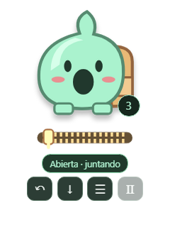

# Mochila

Una mochila de contexto para Windows: juntá textos, capturas y archivos, ordenalos y pegalos en el chat en el que trabajás.

**0.3.0 es una versión de prueba (alpha), sin firma digital.** La recepción de archivos depende de cada aplicación. El historial registra intentos de pegado, no una confirmación del chat.

## Descargar para Windows

[**Descargar Mochila para Windows**](https://github.com/nininxinxinxinxixnixn/mochila/releases/download/v0.3.0/Mochila-Windows-0.3.0.zip) · [Ver la versión 0.3.0 y el código fuente](https://github.com/nininxinxinxinxixnixn/mochila/releases/tag/v0.3.0). Extraelo y ejecutá `Mochila.exe`. Cerrá cualquier versión anterior antes de abrirla. No necesitás Node ni instalar dependencias para usar la descarga.

## Cómo funciona

- Arrastrá directamente el cuerpo del personaje para moverlo.
- Abrí el cierre para juntar textos con Ctrl+C, capturas y archivos arrastrados.
- Cerrá el cierre para pegar en orden con Ctrl+V.
- Desde el panel podés reordenar, quitar y recuperar elementos. ↶ deshace el último ingreso; Ctrl+Z funciona dentro del panel sin reemplazar el deshacer del chat.
- **Descargar cola** pega uno por uno automáticamente, con 750 ms entre intentos y tres segundos para elegir el destino.
- **Preparar MegaPrompt** arma un documento con los textos completos y copias de los adjuntos numerados. **Descargar MegaPrompt** pega esa lista de archivos en una sola operación. Los textos llegan en un archivo Markdown adjunto.
- Esc pausa. Mochila no pulsa Enter ni envía el mensaje.



[Guía paso a paso](docs/GUIA.md) · [Privacidad](PRIVACY.md) · [Licencia](LICENSE)

## Compilar desde el código

Windows x64, Node.js y npm:

```powershell
npm ci --ignore-scripts --no-audit --no-fund
npm rebuild electron esbuild --foreground-scripts
node scripts/mochila-icons.mjs
npm run typecheck
npm run test:mochila
npm run build
node node_modules/electron-builder/cli.js --win portable --publish never
```

Salida: `dist/Mochila-Portable-0.3.0.exe`. Entrada activa: `electron/mochila/main.ts`; interfaz: `src/mochila`. Se conserva código heredado de Edge-Drop, que no equivale a funciones activas de Mochila.

## Estado de las pruebas y límites

El candidato local pasó 68 pruebas propias, 44 pruebas heredadas pertinentes, typecheck, build y 10 comprobaciones del renderer compilado. Las pruebas de entrega usaron un destino simulado. La compatibilidad real con cada chat, el movimiento en distintas configuraciones de pantalla y el rendimiento requieren pruebas de uso. La versión anterior 0.2.0 tuvo reportes de duplicación; 0.3.0 corrige rutas concretas de doble formato y tecla mantenida, sin prometer compatibilidad universal.

Pendientes: firma digital, actualización del Electron heredado, auditoría completa de dependencias y recursos, confirmación de recepción, limpieza de preparados y cifrado integral. No habilites cargas automáticas con contenido sensible sin revisar el destino y la cola. La velocidad de subida depende del chat y de la conexión.

## Créditos

Derivado de [Edge-Drop](https://github.com/Deepender25/Edge-Drop), de Deepender25 y sus colaboradores, commit base `469fd0d56d8d4073ed5a6fbcab36953db8203cae`. Se mantiene Apache-2.0, LICENSE, NOTICE y el [README original](README.upstream.md). Cambios de Mochila: identidad e interfaz en castellano, mascota vectorial original, cola persistente, edición recuperable, control de pegado, descarga automática y MegaPrompt. Sin afiliación ni respaldo de los autores originales.
